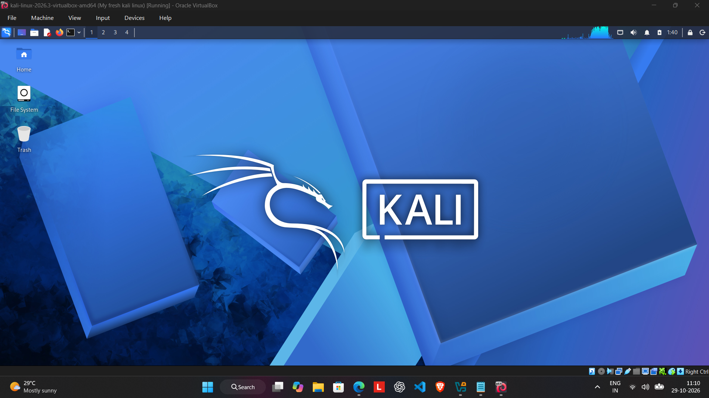
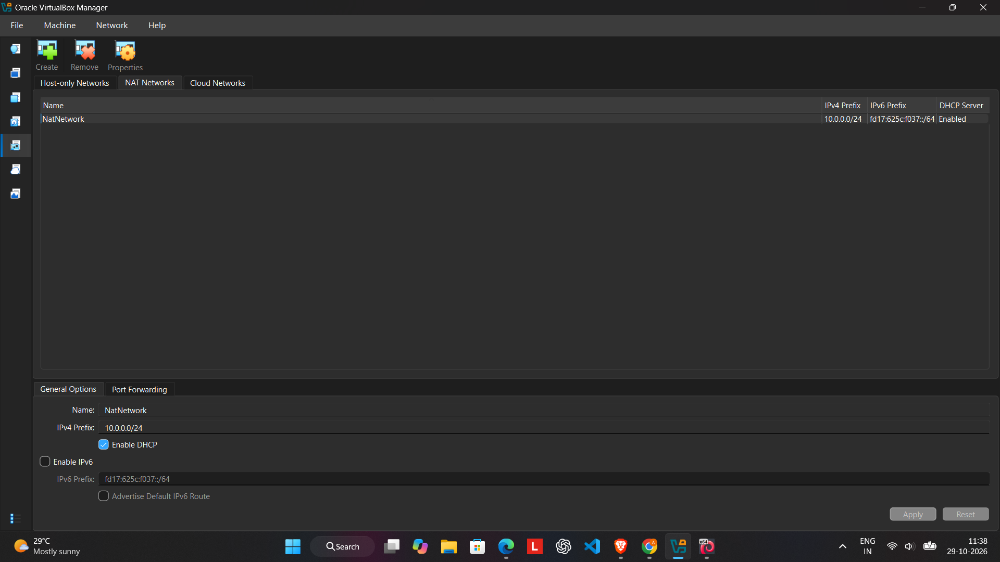
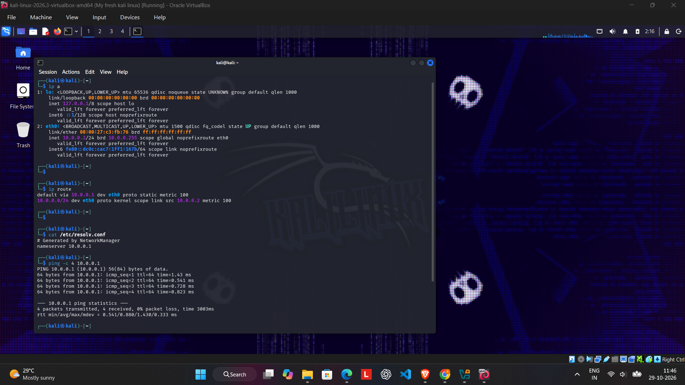
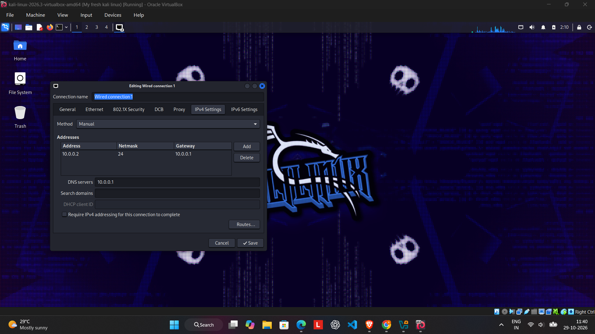

# 🔐 Cybersecurity Lab Environment Setup

Building an isolated virtual lab for penetration testing and ethical hacking practice.

## 📌 Project Overview

This project focuses on setting up a virtual cybersecurity and penetration-testing laboratory using Oracle VirtualBox and Kali Linux.

The purpose of this lab is to create a controlled environment where cybersecurity tools, network scanning, reconnaissance, vulnerability assessment, and other security-testing activities can be practised safely.

The Kali Linux virtual machine is configured with a virtual network, a dedicated IPv4 address, a default gateway, and a DNS server. The environment will serve as a foundation for future authorized security-testing projects.

## 🎯 Objectives

The main objectives of this project are to:

- Configure Oracle VirtualBox on Windows.
- Set up Kali Linux as a virtual machine.
- Configure virtual networking for the Kali VM.
- Verify IP addressing, routing, and DNS settings.
- Test gateway connectivity and DNS resolution.
- Verify Nmap installation.
- Document the setup and verification process.
- Prepare the environment for future cybersecurity exercises.

## 🛡️ Purpose of the Lab

The lab provides a controlled environment for cybersecurity learning and authorized security testing.

It can be used for activities such as:

- Network reconnaissance
- Port scanning
- Vulnerability assessment
- Packet analysis
- Web security testing
- Exploitation practice in authorized labs
- Security-tool experimentation

**Important:** This laboratory must only be used for systems you own or have explicit permission to test.

## 🏗️ Lab Architecture

The lab consists of a Windows 11 host system running Oracle VirtualBox, with Kali Linux operating as a virtual machine.

The Kali VM uses the `10.0.0.0/24` network, with `10.0.0.2` assigned to its network interface and `10.0.0.1` configured as its default gateway and DNS server.

The Windows host also has a VirtualBox Host-Only adapter configured with `192.168.56.1`. This is a separate virtual network interface and is not the Kali VM's configured gateway.

Additional virtual machines can be added to an appropriately configured lab network for future authorized testing.

## ⚙️ Lab Configuration

### Host System

| Component | Configuration |
|---|---|
| Hostname | `AASHISH` |
| Operating System | Microsoft Windows 11 Home Single Language |
| OS Build | `10.0.26300` |
| System Manufacturer | Lenovo |
| System Model | `83DV` |
| System Architecture | x64-based PC |
| Processor | Intel processor, approximately 2.4 GHz |
| Installed RAM | 16,092 MB (approximately 16 GB) |
| Virtualization Status | Hypervisor detected |
| Virtualization Platform | Oracle VirtualBox |

### Kali Linux Virtual Machine

| Component | Configuration |
|---|---|
| Guest Operating System | Kali Linux |
| Architecture | x86_64 |
| Network Interface | `eth0` |
| MAC Address | `08:00:27:c3:fb:76` |
| IPv4 Address | `10.0.0.2/24` |
| Subnet Mask | `255.255.255.0` |
| Network Address | `10.0.0.0/24` |
| Broadcast Address | `10.0.0.255` |
| Default Gateway | `10.0.0.1` |
| Configured DNS Server | `10.0.0.1` |
| Network Configuration Manager | NetworkManager |
| Nmap Version | `7.99` |

### Windows Virtual Network Adapter

| Component | Configuration |
|---|---|
| Adapter | VirtualBox Host-Only Ethernet Adapter |
| Connection Name | `Ethernet 2` |
| IPv4 Address | `192.168.56.1` |
| DHCP Enabled | No |

The Windows host also has VMware virtual adapters. They are separate from the Kali VM's confirmed `10.0.0.0/24` network.

## 🪜 Lab Setup Procedure

### Step 1: Prepare the Host System

The host system runs Microsoft Windows 11 Home Single Language on a Lenovo computer with approximately 16 GB of installed RAM.

VirtualBox provides the environment for running Kali Linux as a virtual machine.

### Step 2: Install Oracle VirtualBox

Oracle VirtualBox is used to create and manage the Kali Linux virtual machine.

Official download: https://www.virtualbox.org/wiki/Downloads

### Step 3: Set Up Kali Linux

Kali Linux is configured as a virtual machine in the virtualization environment.

The VM's network interface is identified as `eth0`, with the IPv4 address `10.0.0.2/24`.

Official download: https://www.kali.org/get-kali/

### Step 4: Configure the Virtual Network

The Kali Linux network configuration uses the following values:

- Network: `10.0.0.0/24`
- Kali IP: `10.0.0.2/24`
- Default gateway: `10.0.0.1`
- DNS server: `10.0.0.1`

The Windows host's VirtualBox Host-Only adapter uses `192.168.56.1`, which belongs to a separate virtual interface.

### Step 5: Verify Network Configuration

The following commands were executed in Kali Linux.

**Inspect the IP address:**

```bash
ip a
```

The output confirmed that `eth0` was up and had the address `10.0.0.2/24`.

**Inspect the routing table:**

```bash
ip route
```

The output confirmed the default route through `10.0.0.1`.

**Inspect DNS configuration:**

```bash
cat /etc/resolv.conf
```

The output showed:

```text
# Generated by NetworkManager
nameserver 10.0.0.1
```

### Step 6: Test Gateway Connectivity

Command:

```bash
ping -c 4 10.0.0.1
```

**Observed results:**

- Packets transmitted: 4
- Packets received: 4
- Packet loss: 0%
- Average round-trip time: 1.040 ms

All four packets received replies, confirming successful connectivity to the configured gateway.

### Step 7: Test DNS Resolution

Command:

```bash
nslookup networkwalks.com
```

**Observed results:**

```text
Server:         10.0.0.1
Address:        10.0.0.1#53

Non-authoritative answer:
Name:   networkwalks.com
Address: 192.232.216.135
```

The domain resolved successfully through the configured DNS server at `10.0.0.1`.

### Step 8: Verify Nmap Installation

Command:

```bash
nmap --version
```

**Observed result:**

```text
Nmap version 7.99
Platform: x86_64-pc-linux-gnu
```

This confirmed that Nmap was installed and its version information was available.

### Step 9: Create a Clean VM Snapshot

After completing the initial setup, create a VirtualBox snapshot to preserve the current lab state.

Suggested snapshot name:

`Clean Kali - Network Setup`

A snapshot provides a recovery point before future experiments. Snapshot creation has not yet been verified in the supplied evidence.

## 🔎 Lab Verification

| Test | Command | Observed Result |
|---|---|---|
| IP address | `ip a` | `10.0.0.2/24` on `eth0` |
| Routing table | `ip route` | Default gateway `10.0.0.1` |
| DNS configuration | `cat /etc/resolv.conf` | Nameserver `10.0.0.1` |
| Gateway connectivity | `ping -c 4 10.0.0.1` | 4 received, 0% packet loss |
| DNS resolution | `nslookup networkwalks.com` | Resolved to `192.232.216.135` |
| Nmap installation | `nmap --version` | Version `7.99` |

## 📸 Screenshots

Add genuine screenshots of your own system to the repository.

Recommended filenames:

1. 
2. 
3. 
4. 

Ensure all referenced screenshots are uploaded to the repository.

## 🐞 Problems Encountered & Solutions

No gateway connectivity or DNS resolution failure was observed in the supplied verification results.

If an issue occurs during future configuration, document it using this format:

**Problem:** Describe the actual error.

**Cause:** Explain the identified cause, if known.

**Solution:** Record the steps used to fix the issue.

**Verification:** Include the command and actual output confirming the fix.

This section should reflect genuine troubleshooting experience rather than assumed problems.

## 💡 What I Learned

Through this project, I learned how to:

1. Set up a virtual cybersecurity environment using Kali Linux.
2. Inspect network interfaces and IPv4 configuration with `ip a`.
3. Understand routing tables and default gateways with `ip route`.
4. Inspect DNS configuration through `/etc/resolv.conf`.
5. Test network connectivity using `ping`.
6. Verify DNS resolution using `nslookup`.
7. Confirm the installation of Nmap.
8. Document system configuration and practical verification results.

## 🔐 Security & Ethical Use

This laboratory is intended for educational purposes and authorized security testing only.

All testing must be restricted to systems I own, isolated lab environments, or systems for which I have explicit permission.

## 🔗 Tools & Resources

- **Oracle VirtualBox:** https://www.virtualbox.org/wiki/Downloads
- **Kali Linux:** https://www.kali.org/get-kali/
- **Nmap:** https://nmap.org/

## 👤 Author

**Aashish Kumar Chaudhary**

B.Tech CSE Student | Cybersecurity Intern

## 📌 Project Information

- **Program Name:** Cybersecurity at Networkwalks
- **Week:** 01
- **Project:** Cybersecurity & Penetration Testing Lab Setup
- **Repository:** `NETWORKWALKS-AASHISH-B084-WK1-PM1-CYBERSECURITY-LAB-SETUP`

---

*This project is part of my hands-on cybersecurity learning journey.*
